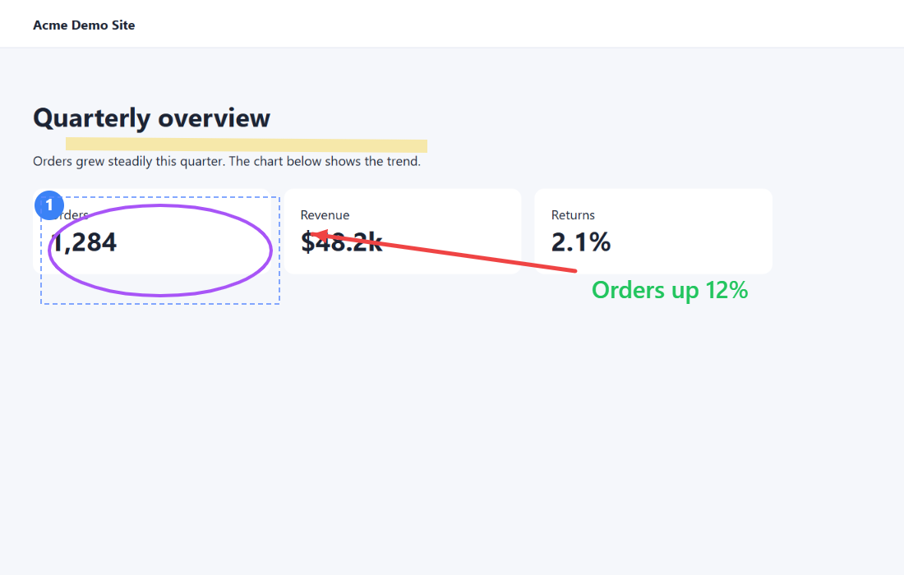
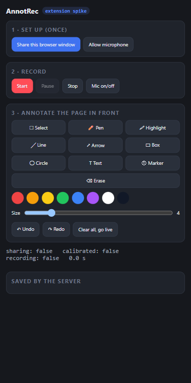

# AnnotRec: Version 3 · Browser extension (Microsoft Edge)

Version 3 of AnnotRec turns the recorder into a **browser extension**. It works on whatever
tab you are looking at: record the page with your microphone, switch tabs while recording,
freeze the page and draw on it while you talk, press **Clear all** to go live again, and get
**one MP4** made by our own FFmpeg server. Installed locally from this codebase (no store).



| | Version 1 | Version 2 | **Version 3 (this branch)** |
|---|---|---|---|
| **Label** | DESKTOP APP, Windows `.exe` | WEB APP, React + Node.js | **BROWSER EXTENSION (Edge) + the Node server** |
| **Branch / tag** | [`main`](../../tree/main) · `v1.0.0` | [`version-2`](../../tree/version-2) · `v2.0.0` | **`version-3`** |
| **What you run** | `AnnotRec.exe` | Node server, page at `localhost:4000` | **The extension loaded in Edge + the Node server** |
| **Records** | A window you pick | The viewport inside the web app | **Any tab, following you across tabs** |
| **MP4 made by** | Native Windows encoder | FFmpeg | **FFmpeg (the same server as Version 2)** |

## Extension: tech stack
- **Manifest V3 extension**, plain JavaScript (no build step beyond copying files): service worker, offscreen document (recorder), content script (drawing layer), side panel (controls).
- **Capture**: `getDisplayMedia` window pick once, then the page is located and cropped by **self-calibration** (the page draws a magenta frame at its edges and the recorder finds it). Follows tab switches, zoom and window resize.
- **Recording**: `MediaRecorder` (H.264 + Opus), microphone through `getUserMedia`. **Pause/resume** cuts the paused time.
- **MP4**: pieces are sent live to the Version 2 Node server (`/api/live?video=copy`); FFmpeg repackages the picture and converts the audio to AAC, so **Stop takes under a second**.
- **Drawing**: Shadow DOM in the browser's top layer; the page is frozen with `captureVisibleTab`.
- **Tests**: Playwright driving real Edge (`extension/spike/test`).

## Extension: quick start
1. Install **Node.js 20+**, **FFmpeg** (on PATH) and **Microsoft Edge**.
2. Get the code and install:
   ```powershell
   git clone -b version-3 https://github.com/Siddharth-cvhs/AnnotRec.git
   cd AnnotRec
   npm install
   ```
3. Start the server, allowing the extension (its id is fixed by `extension/spike/key.json`):
   ```powershell
   $env:ANNOTREC_ALLOWED_ORIGINS = "chrome-extension://kbgonanciofpceomfnheeabchhcjnjbb"
   npm start
   ```
4. Build the extension (writes `extension/spike/dist`):
   ```powershell
   node extension/spike/build.mjs
   ```
5. In Edge open `edge://extensions`, switch on **Developer mode**, click **Load unpacked** and choose `extension/spike/dist`. Pin the AnnotRec icon.
6. Open any website, click the icon to open the side panel, then **Share this browser window** (pick this Edge window, once) and **Allow microphone** (once).
7. Press **Start**, talk, switch tabs, pick a tool to freeze and draw, **Clear all, go live**, **Pause/Resume**, then **Stop**. The MP4 is listed in the panel and saved in the server's `recordings` folder.



**Tools**: Select (V), Pen (B), Highlighter (H), Line (L), Arrow (A), Box (R), Circle (O), Text (T), Numbered marker (M), Eraser (E); 8 colours, size slider; Ctrl+Z / Ctrl+Shift+Z; Delete removes the selected shape; Esc clears and goes live; Shift snaps lines to 45 degrees.

**Tests**: `npm run ext:test` runs 11 suites (about 110 checks, each in its own Edge and server): static quality gate, drawing tools, latency, panel and permissions, failure handling, end-to-end recording with pixel and sound checks, zoom/resize, pause, performance, demo run, auto-reload.

**After you change the code**: `npm run ext:build`. A loaded extension reloads itself (not during a recording); you do not need to touch `edge://extensions`. Only the window share has to be picked again.

**Demo mode**: Alt+Shift+R start/stop, Alt+Shift+P pause/resume, Alt+Shift+D draw/go live, from any page. The toolbar icon shows REC / II, and the panel shows a clock and a microphone level meter.

**Permissions**: the first time, **Allow microphone** opens a tab where the browser asks; if it is refused you see `Microphone: Permission denied` with buttons for Edge's and Windows' microphone settings. Start opens the window picker by itself when needed.

**Where the videos are saved**: in the server's `recordings` folder (`react-and-node/recordings`, or the folder in the `REC_DIR` environment variable). The side panel shows the path, with **Open folder**, **Copy path** and **Show** per file.

**Speed** (measured on a 12-core laptop, recording an animated 1596x946 page): 30 fps in the MP4, the browser uses about 8% of the machine while recording (about 5% of that is the page itself), Stop takes under a second.

**Known limits**: Edge only so far (Chrome and Brave untested); moving a shape is not in the undo history; no pencil tool, screenshot button or library page yet in the extension; some company-managed browsers block unpacked extensions. Research, findings and the roadmap: [`extension/NOTES.md`](extension/NOTES.md).

---

# The Version 2 web app (included in this branch)

The server above is the Version 2 server. Everything below describes the Version 2 web app
(React + Node.js, served on a local port), which this branch still contains and runs.

## Tech stack (Version 2: React + Node.js web app)

**Server (Node.js, JavaScript ES modules)**

| Technology | Version | What it does here |
|---|---|---|
| **Node.js** + npm | 20.19+ (tested 24.14), npm 11 | Runs the server and all the scripts |
| **Express** | 5.3 | The HTTP API and the static files; the router can be mounted in any other Express app |
| **http-proxy-middleware** | 3.0 | The viewport reverse proxy: lets any app be shown in the page, passes WebSockets through |
| **FFmpeg** (a separate program, found on PATH) | 8.1 | Converts the browser's WebM into an H.264 + AAC MP4, live while recording |
| Node built-ins (`child_process`, `stream`, `fs`, `events`) | n/a | Running FFmpeg, streaming uploads, file storage, events |
| Own design: ports (storage, converter), events, server plugins, JSON-lines progress streaming | n/a | See [ARCHITECTURE.md](ARCHITECTURE.md) |

**Client (runs in the browser)**

| Technology | Version | What it does here |
|---|---|---|
| **React** + **TypeScript** | 19.3 + 7.0 | The UI shell and the features |
| **Vite** | 8.3 | Dev server with hot reload, and the production build (two pages: the app and an embedding example) |
| **lucide-react** | 1.73 | Icons |
| Own framework-free core: services, registries, typed event bus, stores | n/a | The plugin architecture (no Redux or similar) |
| HTML **canvas** + plain CSS (design tokens) | n/a | The drawing engine (own shape and tool registries) and the styling |

**Browser features it relies on:** tab capture (`getDisplayMedia`), **Region Capture**
(`CropTarget` / `cropTo`) to record only the viewport, `MediaRecorder` (VP9 + Opus WebM),
`getUserMedia` and Web Audio (microphone and level meter), `createImageBitmap`,
`ResizeObserver`. Region Capture only exists in **Chromium browsers (Edge, Chrome 104+)**.

**Testing and tooling:** **Playwright** (`playwright-core` 1.65) driving the real Edge,
FFmpeg/ffprobe to analyse the recorded MP4s pixel by pixel, `concurrently` 9.2 for development,
`tsc` for type checking.

## Quick start (Version 2)

### 1. What you need

| Need | Tested with | Check it |
|---|---|---|
| **Node.js** 20.19 or newer, with npm | 24.14 | `node -v` |
| **FFmpeg** on your PATH (or set `FFMPEG_PATH`) | 8.1 | `ffmpeg -version` |
| **Microsoft Edge or Google Chrome**, version 104 or newer | Edge 157 | needed for Region Capture |
| A microphone | any | optional; without one it records silently |

No Rust and no Visual Studio are needed. Not installed yet? From PowerShell:
`winget install OpenJS.NodeJS` and `winget install Gyan.FFmpeg`, then open a new terminal.

### 2. Get the code and install

```bash
git clone -b version-2 https://github.com/Siddharth-cvhs/AnnotRec.git
cd AnnotRec          # you are on version-2 = Version 2
npm run setup        # installs the server and the client, once
```

### 3a. Run it

```bash
npm run build        # builds the React app
npm start            # serves everything on http://localhost:4000
```

Open **http://localhost:4000** in Edge or Chrome. The terminal prints the address, where
recordings are saved and whether FFmpeg was found.

### 3b. Run it while developing (hot reload)

```bash
npm run dev          # API on :4000, React dev server on http://localhost:5173
```

Open **http://localhost:5173**. Edits to the client reload instantly and the server restarts
when you change it.

**Options:** `PORT` (default 4000), `PROXY_PORT` (default `PORT + 1`), `REC_DIR` (where
recordings go, default `recordings/`) and `FFMPEG_PATH`. In PowerShell:
`$env:PORT = 5000; npm start`.

### 4. Using it for the first time

1. Type your app's address (for example `localhost:3000`) and press Go, or use the demo page.
2. Press **Start**. When the browser asks what to share, choose **This tab**. Allow the
   microphone.
3. Pick a drawing tool: the page freezes while you draw and talk and recording continues.
   **Clear all** brings the live page back.
4. Press **Stop**: the MP4 is ready in the Saved list in a second or so, in `recordings/`.

### 5. Check that everything works (optional)

```bash
node scripts/scenarios.mjs      # 45 scenarios in real Edge windows, about 8 minutes
```

| Problem | Fix |
|---|---|
| "FFmpeg not found" in the terminal or the app | Install FFmpeg, or set `FFMPEG_PATH`, then restart |
| "This browser can't record just a region" | Use Edge or Chrome 104+ at `http://localhost`, not Firefox or Safari |
| Port 4000 is already in use | Set another `PORT` (see Options) |
| Start does nothing or the video is empty | Choose "This tab" in the share prompt and keep the tab visible |
| A page won't show inside the viewport | Strict single sign-on sites may not work through the proxy; try your localhost app |

## Using it

1. Type your app's address (e.g. `localhost:3000`) and press Go. The built-in
   sample page shows until you do. Pick a viewport size if you like.
2. **Start** (`R`). Choose **This tab** when your browser asks (once per
   session). After a 3-second countdown, only the viewport is recorded, never
   the panel or the address bar.
3. Talk and use the page normally, then pick a drawing tool: the page
   **freezes** (recording and microphone keep going) and you draw. **Clear all**
   (`Esc`) removes the ink and gives you the live page back.
4. Pause / Resume (`Space`), mic on/off (`Shift+M`), Screenshot (`S`) at any
   time. **Stop** (`Shift+R`) and the MP4 is ready almost at once. Play it,
   download it, or show it in its folder from the "Saved" list.

**Tools:** select/move (`V`), pen (`B`), pencil (`N`), highlighter (`H`), line
(`L`), arrow (`A`), rectangle (`U`), circle (`O`), text (`T`), numbered marker
(`M`), eraser (`E`); hold **Shift** while drawing for straight lines and
squares/circles; `Ctrl+Z` / `Ctrl+Y` undo and redo; `Delete` removes the
selected shape; colours, a custom colour and stroke size. Press `?` in the app
for the full list. Shortcuts work when the app page has focus: click outside the
viewport first if you were using the page.

Settings (countdown, video quality, microphone default) are remembered in the
browser.

## How it works

```
 Browser (React)                                       Node server
 ┌─────────────────────────────────┐  WebM pieces     ┌───────────────────────┐
 │ viewport <div> ← iframe         │ ───────────────▶ │ FFmpeg converts as it │
 │   + overlay canvas (ink)        │  while recording │ arrives → MP4         │
 │ panel, address bar              │ ◀──── /api ───── │ Express API           │
 └────────────────┬────────────────┘                  │ viewport proxy :4001  │
  tab capture + cropTo(viewport)                      │ (strips frame blocks) │
  MediaRecorder (+ microphone)                        └───────────────────────┘
```

* **Capture.** `getDisplayMedia` on the current tab records the page as it is on
  screen (the iframe, the frozen picture and the ink). **Region Capture**
  (`CropTarget` / `cropTo`) cuts the stream to the viewport element, and exact
  size constraints make it pixel-for-pixel the viewport (no scaling). `MediaRecorder`
  records that plus the microphone.
* **Freeze without pausing** (`useApp.ts`, `Overlay.tsx`). Choosing a tool grabs
  the newest frame of the same stream straight from memory (a few milliseconds),
  paints it on a canvas over the iframe and lets the drawing canvas take the
  mouse. The recorder is never touched, so the video shows the frozen page and the
  ink appearing while your voice continues.
* **Live conversion** (`server/index.js`, `api.ts`). While recording, the WebM
  goes to the server in one-second pieces and FFmpeg encodes them as they
  arrive, so pressing Stop only finishes the last piece (about 0.3-1 s however
  long the recording is). The browser keeps every piece; if anything on that
  path fails it uploads the whole recording instead.
* **Viewport proxy** (`server/proxy.js`). Many apps refuse to be shown in an
  iframe. A small reverse proxy on its own port forwards to your app and removes
  `X-Frame-Options` / CSP `frame-ancestors`. A port of its own keeps
  root-relative URLs and WebSockets (hot reload) working. It listens on
  `127.0.0.1` only.
* **Safety.** The server answers only requests whose Host and Origin are this
  machine (no DNS-rebinding, no other websites), accepts only http(s)
  addresses, only touches files with plain `.mp4`/`.png` names inside the
  recordings folder, and kills an abandoned conversion after 90 s.

## Structure (loosely coupled, built to be extended)

Read **[ARCHITECTURE.md](ARCHITECTURE.md)** for the full picture. In short:

* **Client** (`client/src`): a framework-free **core** (services, registries, event bus) that only
  talks to the world through **ports**; **adapters** implement them for the browser and the
  server; every feature is a **plugin** that registers commands, shortcuts, tools, shapes,
  panels, dialogs or recording destinations; the React **shell** just renders slots.
  A new feature is a new file (see `client/src/examples/notes.tsx`), not an edit to the core.
* **Server** (`server/src`): `createAnnotRec(options)` returns a router you can mount under any
  path in another Express app, with swappable storage and converter ports, events and server plugins.
* Embed it: `<AnnotRec apiBase="/tools/annotrec" plugins={[myPlugin]} />` (client) and
  `app.use("/tools/annotrec", createAnnotRec({...}).router)` (server). `/host.html` is a working
  example of a host page with an extra plugin and an extra recording destination.

| Path | Role |
|---|---|
| `server/index.js` | standalone entry: the router and the built app on one port |
| `server/src/annotrec.js` | the server factory (ports, events, plugins) |
| `server/src/routes/` | core (health, target), library (files), live (conversion while recording) |
| `client/src/core/` | kernel, registries, services, ink engine, ports, contracts |
| `client/src/features/` | recording, annotation, screenshot, library, viewport, dialogs, chrome |
| `client/src/adapters/` | browser capture + recorder, HTTP, storage |
| `client/src/ui/` | shell, slots, viewport, hooks |
| `scripts/scenarios.mjs` | the scenario suite (below) |
| `scripts/perf.mjs` | performance measurements |
| `scripts/e2e.mjs`, `scripts/shots.mjs` | quick end-to-end run; screenshots of every UI state |

## Tests

```bash
npm run setup
node scripts/scenarios.mjs            # 45 scenarios, ~8 minutes
node scripts/scenarios.mjs --long     # 46: adds a 60 s endurance recording
node scripts/scenarios.mjs --only=S05,U05
node scripts/perf.mjs                 # measurements
```

The suite starts its own server and a test app that refuses to be framed, and
drives real visible Microsoft Edge windows (no clicking needed: Edge flags
auto-accept "share this tab" and supply a fake microphone). Every recording is
analysed pixel by pixel with FFmpeg: ink must be in the video exactly while the
page is frozen, at the right place at 1.5x display scaling; the video must be
exactly the viewport; audio and video lengths must match; a pause must be cut
out. It also covers the API and security checks, the proxy (redirects,
root-relative assets, a dead target), error paths (no microphone, cancelled
share, "Stop sharing", closing the tab, FFmpeg cancelled mid-conversion),
keyboard shortcuts, settings, the library, and accessibility basics. A group of
scenarios proves the architecture's promises: swapped server ports, the router mounted inside
another Express app, a plugin extending the app without touching the core, a custom recording
destination, excluded features, a crashing plugin, and driving the app purely through commands.

## Performance (measured on the development machine)

| What | Result |
|---|---|
| First paint / app code | ~0.5 s / 88 KB gzipped |
| Tool click to frozen page | ~65 ms |
| Drawing | 60 fps, no long tasks, also while recording |
| DOM activity while recording | ~34 writes per second (timer and mic meter) |
| Stop to saved MP4 | ~0.3-1 s regardless of length |
| MP4 conversion speed | ~10x faster than real time |

## Limits

* Chromium browsers only (Edge, Chrome): Region Capture is not in Firefox or
  Safari. Open it at `http://localhost`/`127.0.0.1` (a secure context), not over
  a LAN address.
* You approve "share this tab" once per browser session. Very occasionally
  the browser starts a capture without delivering any picture: the app retries
  once, then asks you to try again with the tab in front.
* The proxy handles typical dev apps. Sites with strict single sign-on, cookies
  tied to their own domain, or anti-framing scripts may not work inside it. The
  proxy shows one page at a time, so use one browser tab of the app.
* Keep the browser tab visible while recording; a hidden or covered tab can stop
  delivering frames.
* The viewport size is locked while recording.
* No captions and no system (speaker) audio yet.
* Nothing leaves your machine.
